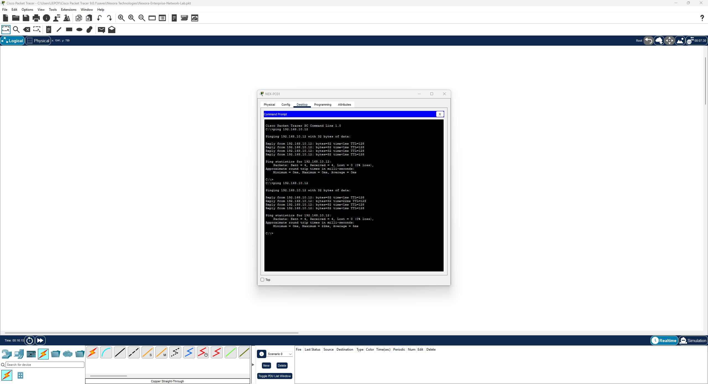
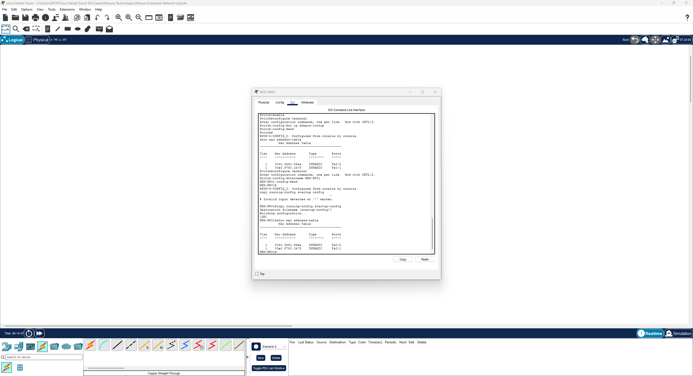

# Lab 01 - Basic LAN Connectivity

## Objective
Build a small local area network (LAN), configure static IP addresses,
verify connectivity, and inspect the switch MAC address table.

## Environment
- Cisco Packet Tracer
- One Cisco 2960 switch
- Two PCs
- Copper straight-through Ethernet cables

## Network Configuration

| Device | Interface | IP Address | Subnet Mask | Switch Port |
|---|---|---|---|---|
| NEX-PC01 | FastEthernet0 | 192.168.10.11 | 255.255.255.0 | Fa0/1 |
| NEX-PC02 | FastEthernet0 | 192.168.10.12 | 255.255.255.0 | Fa0/2 |
| NEX-SW01 | — | Not configured | — | — |

Both PCs belong to the 192.168.10.0/24 network.
Default gateways and DNS servers were left unconfigured.
A gateway is unnecessary for communication within this subnet.

## Configuration Steps
1. Placed one Cisco 2960 switch and two PCs.
2. Connected each PC to the switch using copper straight-through cables.
3. Confirmed both physical links turned green.
4. Assigned each PC a unique static IP address.
5. Tested connectivity in both directions.
6. Renamed the devices.
7. Inspected the switch MAC address table.
8. Configured the switch hostname and saved its configuration.

## Switch Commands

Entered privileged EXEC mode:

    enable

Disabled DNS lookups for unrecognized commands:

    configure terminal
    no ip domain-lookup
    end

Displayed learned MAC addresses:

    show mac address-table

Configured the hostname and saved the configuration:

    configure terminal
    hostname NEX-SW01
    end
    copy running-config startup-config

Accepted the default destination filename by pressing Enter.
The switch displayed [OK] to confirm the save.

## Verification Results

| Test | Result |
|---|---|
| NEX-PC01 ping to 192.168.10.12 | 4 sent, 4 received, 0 lost |
| NEX-PC02 ping to 192.168.10.11 | 4 sent, 4 received, 0 lost |
| Switch MAC address table | Dynamic entries on Fa0/1 and Fa0/2 |
| Save switch configuration | [OK] confirmation |

### Successful Connectivity

### Switch MAC Address Table

## Lessons Learned
- Devices in the same subnet can communicate through a Layer 2 switch
  without a router.
- Each PC needs a unique IP address.
- A switch learns source MAC addresses from incoming Ethernet frames
  and associates them with ports.
- Dynamic MAC address entries can expire after inactivity.
- Changing a device display name is separate from configuring its
  CLI hostname.
- Saving the startup configuration preserves switch settings across
  a restart; saving the .pkt file preserves the Packet Tracer project.
