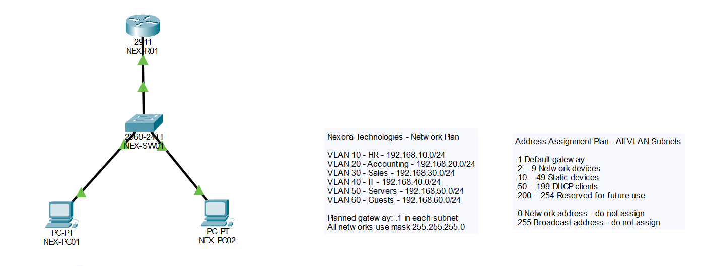
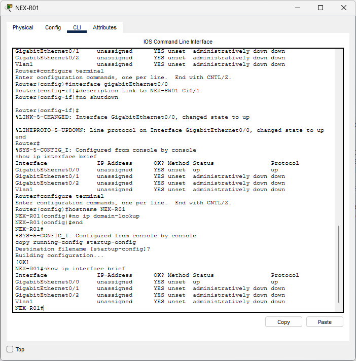

# Lab 02 - Network Design and IP Address Planning

## Objective
Plan Nexora Technologies' departmental networks and IP address assignments, add a router, and verify its physical connection
to the existing switch.

## Environment
- Cisco Packet Tracer
- NEX-R01: Cisco 2911 router
- NEX-SW01: Cisco 2960 switch
- NEX-PC01 and NEX-PC02: Workstations

## Planned VLANs and Subnets

| Department / Purpose | VLAN ID | Subnet | Planned Gateway |
|---|---|---|---|
| HR | 10 | 192.168.10.0/24 | 192.168.10.1 |
| Accounting | 20 | 192.168.20.0/24 | 192.168.20.1 |
| Sales | 30 | 192.168.30.0/24 | 192.168.30.1 |
| IT | 40 | 192.168.40.0/24 | 192.168.40.1 |
| Servers | 50 | 192.168.50.0/24 | 192.168.50.1 |
| Guests | 60 | 192.168.60.0/24 | 192.168.60.1 |

All subnets use the mask 255.255.255.0.

Each subnet provides 254 usable host addresses. This lab uses /24
subnets for a consistent, easy-to-follow addressing scheme.

VLAN IDs match the third octet of their subnets for readability.
This is a design choice, not a networking requirement.

## Address Assignment Plan

The following pattern applies within each planned subnet:

| Address Range | Purpose |
|---|---|
| .1 | Default gateway |
| .2-.9 | Network devices |
| .10-.49 | Statically assigned devices |
| .50-.199 | Planned DHCP pool |
| .200-.254 | Reserved for future use |

The .0 address identifies the network, and .255 is the broadcast
address in these /24 subnets. Neither is assigned to a host.

NEX-PC01 and NEX-PC02 retain their static addresses:
- NEX-PC01: 192.168.10.11/24
- NEX-PC02: 192.168.10.12/24

These addresses fit the planned HR subnet. The HR VLAN has not
yet been configured.

## Physical Connection

| Device | Interface | Connected Device | Connected Interface |
|---|---|---|---|
| NEX-R01 | GigabitEthernet0/0 | NEX-SW01 | GigabitEthernet0/1 |

The devices are connected using a copper straight-through cable.

This link is intended to carry multiple VLANs later. Trunking and
router subinterfaces have not yet been configured.

## Router Configuration

Checked the initial interface status:

    enable
    show ip interface brief

GigabitEthernet0/0 initially showed:
- Status: administratively down
- Protocol: down

Enabled and labeled the interface:

    configure terminal
    interface gigabitEthernet0/0
    description Link to NEX-SW01 Gi0/1
    no shutdown
    end
    show ip interface brief

Configured the router hostname and disabled DNS lookups for
unrecognized commands:

    configure terminal
    hostname NEX-R01
    no ip domain-lookup
    end

Saved the configuration:

    copy running-config startup-config

Accepted the default destination filename by pressing Enter.
The router displayed [OK].

## Verification Results

| Check | Result |
|---|---|
| Router display name | NEX-R01 |
| Router CLI hostname | NEX-R01 |
| GigabitEthernet0/0 status | up |
| GigabitEthernet0/0 protocol | up |
| GigabitEthernet0/0 IP address | Unassigned |
| Startup configuration saved | [OK] |
| VLAN and address planning notes | Added to topology |

The up/up interface confirms that the link is operational.
It does not demonstrate inter-VLAN routing.

### Network Design

### Router Interface Status

## Current Implementation Boundaries
- Departmental VLANs are planned but not configured.
- Gateway addresses are planned but not assigned.
- DHCP, NAT, and access control lists are not configured.
- The router-to-switch link is not yet configured as a trunk.
- Existing PCs remain in the switch's default VLAN.

## Lessons Learned
- Network planning defines subnets, gateways, and address allocations
  before configuring services.
- VLANs separate Layer 2 broadcast domains; routing allows traffic
  to move between their subnets.
- An administratively down interface is disabled by configuration.
- The no shutdown command enables an interface.
- Interface descriptions help identify connections.
- Display names and CLI hostnames are separate settings.
- A router interface can be up/up without an assigned IP address.

## Status
Completed: network planning, router setup, and physical link verification.
