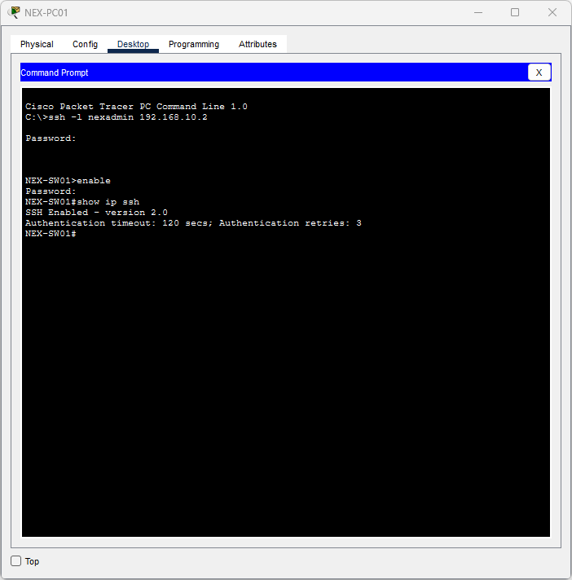
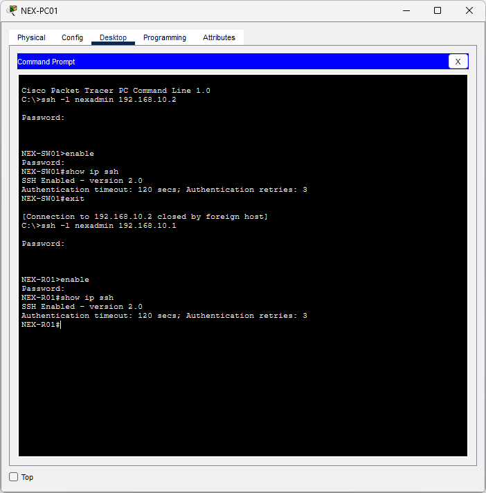

# Lab 03 - Basic Device Configuration and Secure Management

## Objective

Protect router and switch administration using enable secrets,
local accounts, console authentication, and SSH version 2.
Verify successful SSH access and rejection of Telnet sessions.

## Environment

| Device | Model | Management Address |
|---|---|---|
| NEX-R01 | Cisco 2911 router | 192.168.10.1/24 |
| NEX-SW01 | Cisco 2960 switch | 192.168.10.2/24 |
| NEX-PC01 | PC | 192.168.10.11/24 |
| NEX-PC02 | PC | 192.168.10.12/24 |

The router address is temporarily assigned to GigabitEthernet0/0.
The switch address is temporarily assigned to interface VLAN 1.

All devices currently share the same subnet and default VLAN.
No default gateway is required for these local management tests.

## Password Placeholders

Commands below use placeholders instead of actual passwords.
Use unique lab credentials when reproducing the configuration.

## Enable Secret

Configured on both NEX-R01 and NEX-SW01:

    configure terminal
    enable secret (password)
    end

Tested by leaving privileged mode and entering it again:

    disable
    enable

Entering the correct enable password returned each device to its
privileged EXEC prompt, identified by #.

## Local Account and Console Authentication

Configured on both devices:

    configure terminal
    username nexadmin secret (password)
    line console 0
    login local
    exec-timeout 5 0
    logging synchronous
    end

- login local authenticates console users against the local account database.
- exec-timeout 5 0 disconnects idle console sessions after five minutes.
- logging synchronous redraws the prompt and input line after system messages.

The account uses the default user privilege level. After login,
the enable secret is required to enter privileged EXEC mode.

### Console Verification

Exited each console session and logged back in using nexadmin.
Entered enable and supplied the enable password.

Both devices successfully returned to their privileged EXEC prompts.

## SSH Key Generation

Hostnames and no ip domain-lookup were configured in earlier labs.

Configured on both devices:

    configure terminal
    ip domain-name nexora.test
    crypto key generate rsa

Selected 2048 bits when prompted for the RSA modulus size.

The domain name is used with the hostname for key generation.
It does not configure a DNS server.

## Router SSH Configuration

On NEX-R01:

    ip ssh version 2
    line vty 0 4
    login local
    transport input ssh
    exec-timeout 5 0
    end
    show ip ssh

## Switch SSH Configuration

On NEX-SW01:

    ip ssh version 2
    line vty 0 15
    login local
    transport input ssh
    exec-timeout 5 0
    end
    show ip ssh

VTY lines handle remote terminal sessions.
The configured lines require local authentication and accept SSH.

Both devices reported SSH version 2.0 enabled.
The router also reported an authentication timeout of 120 seconds
and three authentication retries.

The authentication timeout applies to establishing a login.
The five-minute EXEC timeout applies to inactivity after login.

## Temporary Management IP Addresses

### Switch

    configure terminal
    interface vlan 1
    description Temporary management interface
    ip address 192.168.10.2 255.255.255.0
    no shutdown
    end
    show ip interface brief

Verified that Vlan1 had the correct address and showed up/up.

This switch virtual interface provides IP access to the switch itself.
It does not enable inter-VLAN routing.

### Router

    configure terminal
    interface gigabitEthernet0/0
    ip address 192.168.10.1 255.255.255.0
    end
    show ip interface brief

GigabitEthernet0/0 was already enabled in Lab 02.
Verified the correct address and up/up status.

The physical interface address will be moved to an HR subinterface
when router-on-a-stick routing is configured in a later lab.

## SSH Verification

From NEX-PC01's Command Prompt:

    ssh -l nexadmin 192.168.10.2

Authenticated with the switch account password, then entered enable
and supplied the switch enable password.

Successfully reached NEX-SW01# and ran:

    show ip ssh

Used exit to close the SSH session and return to the PC prompt.

Repeated the process for the router:

    ssh -l nexadmin 192.168.10.1

Successfully reached NEX-R01# and ran show ip ssh.

### Switch SSH Evidence

### Router SSH Evidence

## Telnet Verification

From NEX-PC01:

    telnet 192.168.10.2
    telnet 192.168.10.1

Both attempts displayed an open message followed by connection closure.
Neither presented an interactive login prompt.

Together with successful SSH tests, these results verified the
configured remote access restriction in this simulation.

## Saving Configurations

Saved the configuration on both devices:

    copy running-config startup-config

Accepted the default destination filename.
Each device displayed [OK].

Also saved the Packet Tracer project using Ctrl + S.

## Troubleshooting and Lessons Learned

- A prompt ending in > indicates user EXEC mode; # indicates privileged EXEC mode.
- Local account authentication and enable authentication serve different purposes.
- Password characters are not displayed while being entered at login prompts.
- show ip ssh confirms SSH service status; an actual client connection
  verifies network reachability and authentication.
- exit from an SSH session returns to the PC's command prompt.
- SSH encrypts management sessions; Telnet does not.
- Management access currently works within the local subnet.
- Departmental access restrictions will be added in later labs.
