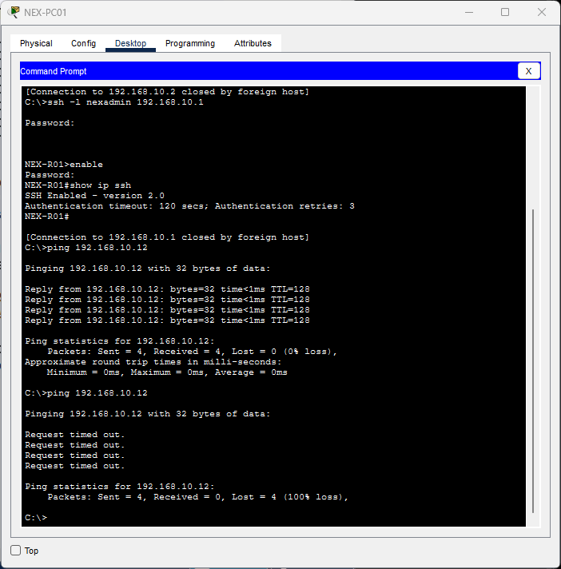
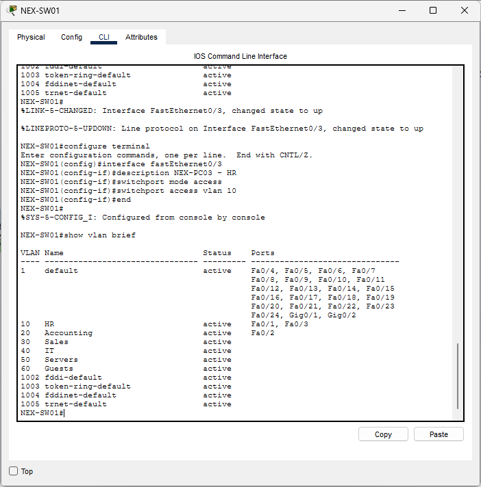
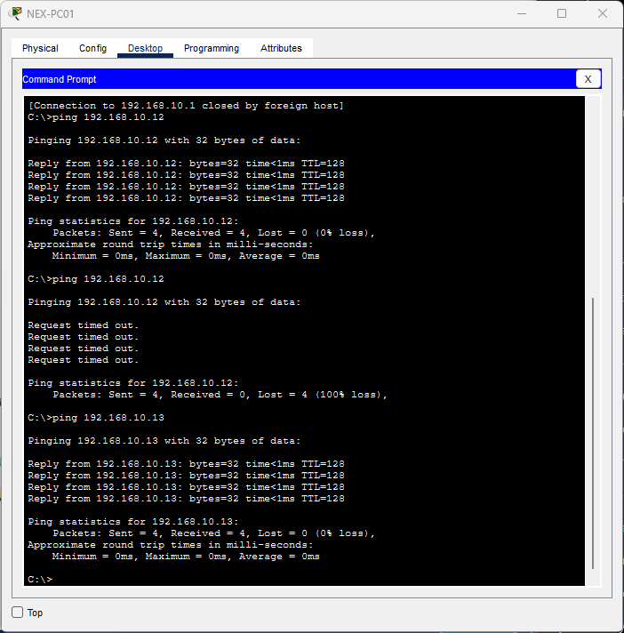

# Lab 04 - Departmental VLANs and Access Ports

## Objective

Create departmental VLANs, assign workstation access ports,
and test communication within a VLAN and isolation between VLANs.

## VLAN Configuration

Created the following VLANs on NEX-SW01:

| VLAN ID | Name |
|---|---|
| 10 | HR |
| 20 | Accounting |
| 30 | Sales |
| 40 | IT |
| 50 | Servers |
| 60 | Guests |

Commands:

    configure terminal
    vlan 10
    name HR
    exit
    vlan 20
    name Accounting
    exit
    vlan 30
    name Sales
    exit
    vlan 40
    name IT
    exit
    vlan 50
    name Servers
    exit
    vlan 60
    name Guests
    exit
    end
    show vlan brief

Verified that all six VLANs appeared with active status.
Creating VLANs alone did not change existing port assignments.

## Initial Same-VLAN Test

Assigned both original PC ports to VLAN 10:

    configure terminal
    interface range fastEthernet0/1 - 2
    switchport mode access
    switchport access vlan 10
    end
    show vlan brief

From NEX-PC01:

    ping 192.168.10.12

Result: 4 sent, 4 received, 0 lost.

Both PCs could communicate while in the same VLAN and IP subnet.

## Controlled VLAN Isolation Test

Moved NEX-PC02's port to VLAN 20 while temporarily keeping
its original IP address of 192.168.10.12/24:

    configure terminal
    interface fastEthernet0/2
    switchport access vlan 20
    end
    show vlan brief

Verified:
- VLAN 10 contained Fa0/1.
- VLAN 20 contained Fa0/2.

Repeated the ping from NEX-PC01:

    ping 192.168.10.12

Result: 4 sent, 0 received, 4 lost.

The controlled port change separated the PCs into different
Layer 2 broadcast domains. Matching IP subnet settings alone
did not allow communication across the VLAN boundary.

This temporary addressing arrangement was used only for the test.
It was corrected afterward.

### Isolation Evidence

## Accounting Address Assignment

Updated NEX-PC02 through Desktop > IP Configuration:

| Setting | Value |
|---|---|
| IP address | 192.168.20.12 |
| Subnet mask | 255.255.255.0 |
| Default gateway | Not configured |
| DNS server | Not configured |

This aligns the PC with the planned Accounting subnet.

## Additional HR Workstation

Added NEX-PC03 and connected its FastEthernet0 interface
to NEX-SW01 FastEthernet0/3 using a copper straight-through cable.

Configured the switch port:

    configure terminal
    interface fastEthernet0/3
    description NEX-PC03 - HR
    switchport mode access
    switchport access vlan 10
    end
    show vlan brief

Configured NEX-PC03:

| Setting | Value |
|---|---|
| IP address | 192.168.10.13 |
| Subnet mask | 255.255.255.0 |
| Default gateway | Not configured |
| DNS server | Not configured |

## Final Workstation Assignments

| Device | Switch Port | VLAN | Department | IP Address |
|---|---|---|---|---|
| NEX-PC01 | Fa0/1 | 10 | HR | 192.168.10.11/24 |
| NEX-PC02 | Fa0/2 | 20 | Accounting | 192.168.20.12/24 |
| NEX-PC03 | Fa0/3 | 10 | HR | 192.168.10.13/24 |

VLANs 30, 40, 50, and 60 exist but have no assigned access ports.

### VLAN and Port Evidence

## Final HR Connectivity Test

From NEX-PC01:

    ping 192.168.10.13

Result: 4 sent, 4 received, 0 lost.

PC01 and PC03 successfully communicated within VLAN 10
and the 192.168.10.0/24 subnet.

### HR Connectivity Evidence

## Management and Routing Status

The switch management address remains 192.168.10.2/24 on VLAN 1.
The router address remains 192.168.10.1/24 on GigabitEthernet0/0.
The router-facing switch port remains in VLAN 1.

Moving the HR PCs into VLAN 10 separates them from these
temporary management interfaces, despite the matching IP subnet.

Device CLI tabs were used for switch configuration.
Management addressing and VLAN connectivity will be adjusted
during the following lab.

Trunking and inter-VLAN routing are not configured yet.
VLAN separation alone does not define access permissions once
routing is enabled; access controls will be added in later labs.

## Saving

On NEX-SW01:

    copy running-config startup-config

Accepted the default destination filename and confirmed [OK].
Saved the Packet Tracer project using Ctrl + S.

## Verification Summary

| Test | Result |
|---|---|
| VLANs 10 through 60 created | Active |
| PC01 to PC02 when both were in VLAN 10 | 4/4 replies |
| PC01 to PC02 after moving PC02 to VLAN 20, retaining its old IP | 0/4 replies |
| PC02 addressing corrected for Accounting | 192.168.20.12/24 |
| PC03 assigned to HR | VLAN 10, Fa0/3 |
| PC01 to PC03 within HR | 4/4 replies |
| Switch configuration saved | [OK] |

## Lessons Learned

- VLANs create separate Layer 2 broadcast domains.
- Access ports associate connected workstations with a VLAN.
- Devices need suitable VLAN placement and IP addressing.
- Devices in different VLANs cannot communicate merely because
  their addresses belong to the same IP subnet.
- Routing and appropriate gateways are needed for communication
  between different VLAN subnets.
- A controlled configuration change helps demonstrate cause and effect.
- Management connectivity must be considered when changing VLAN membership.
